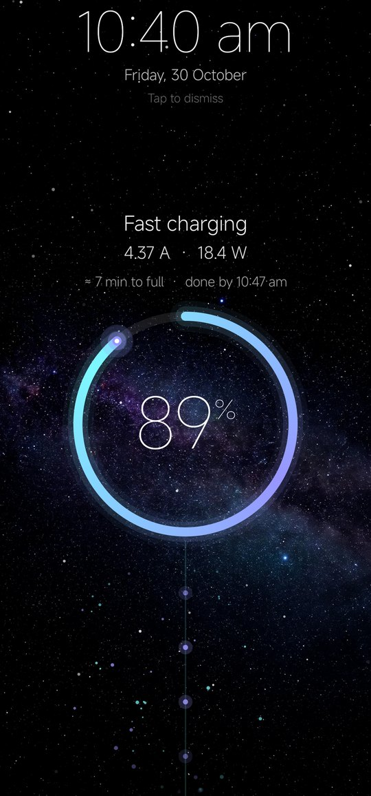
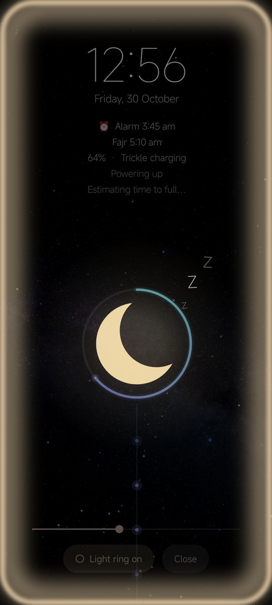
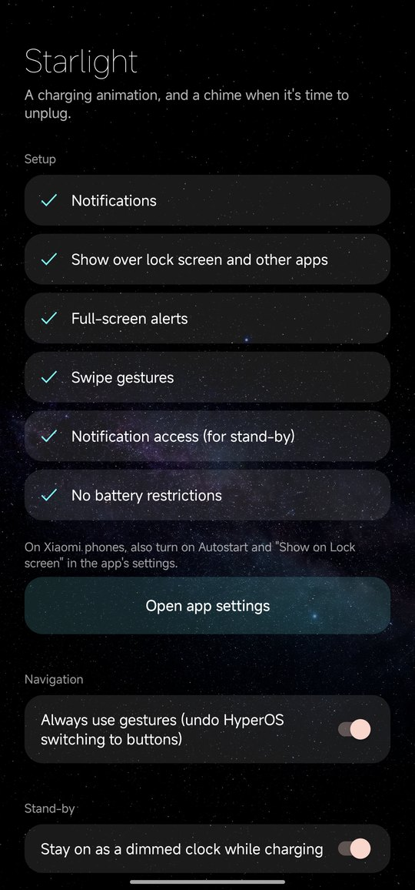
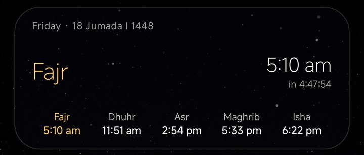
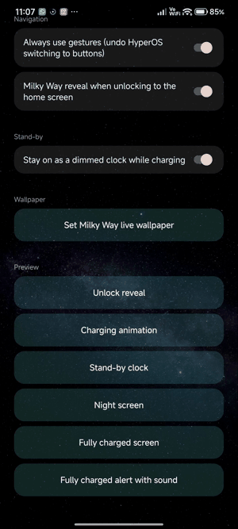

# Starlight

A Milky Way–themed companion app for Android, built for a Xiaomi phone on HyperOS used with a third-party launcher. It covers charging, the night, prayer times and swipe navigation, all in one starry look.

<p align="center">
  
  &nbsp;
  
  &nbsp;
  
</p>

## Features

### Charging
- **Plug-in animation.** A ring fills to the battery level while energy streams up from the charging port. The animation's speed, particle count and colour follow the real charging power. Above about 33 W it turns gold-white, with lightning arcs.
- **Live figures.** Battery current, power and time to full, updated every second. HyperOS's own time estimate is used only when it's plausible; otherwise Starlight estimates from capacity and current, allowing for the slowdown above 80%.
- **Stand-by clock.** While charging, the screen stays on dimmed, with a large clock, date, latest notifications and a small charging ring. Everything drifts slowly to protect the OLED panel.
- **Fully-charged alert.** A soft chime and an "unplug your phone" notification at 100%. It won't chime if the phone was already full when plugged in.

### Night
- **Sleeping screen.** Plug in between 9 pm and 7 am and the phone goes straight to a breathing crescent moon with drifting z's, wrapped in a battery ring with its energy stream. It also shows the time, date, the next Clock-app alarm, the next prayer and charging details.
- **Light ring.** A warm, adjustable glow around the screen edge, for use as a night light.
- **Night notification.** A silent "Night mode" notification on the lock screen reopens the sleeping screen.
- The night ends at 7 am, or earlier at your first Clock-app alarm. Alarms registered by other apps (such as prayer apps) are ignored.

### Home screen widgets
- **Prayer times.** The Shia Ithna-Ashari (Jafari) method: Fajr 16°, Maghrib 4°, Isha 14°, Asr shadow factor 1. Shows the next prayer with a live countdown, all five times and the Hijri date. It uses the PrayTimes.org formulas and matched ShiaLink to the minute in testing.
- **Up next.** Your next calendar event in a quiet glass card, with how soon it starts and how many more are left today.

<p align="center"></p>

### Gestures for third-party launchers
HyperOS runs its gesture navigation only with Xiaomi's own launcher. Starlight's accessibility service adds thin, invisible strips along the screen edges instead:

| Gesture | Action |
|---|---|
| Swipe up from the bottom | Home |
| Swipe up and hold, or a slow swipe past the middle | Recent apps |
| Swipe sideways along the bottom | Previous / next app |
| Swipe in from either side | Back |

Each gesture shows a small glyph: a back bubble, a rising handle, a card stack, or the icon of the app being switched to. The strips step aside on the lock screen and in 3-button mode. Starlight reads only the package name of the app in front (to order recent apps), never what's on the screen. If HyperOS resets navigation to buttons, Starlight switches gestures back on.

### Unlock reveal
When you unlock straight to the home screen, a flash at the fingerprint sensor sends a ring of starlight sweeping out across the home screen, with cyan and violet warp streaks and sparks racing to the edges. It only adds light, never covers anything, and lasts 0.85 seconds. Starlight starts it the moment your fingerprint is accepted (`isDeviceLocked`), usually within a frame or two of HyperOS showing the home screen. When HyperOS reports the unlock late (it sometimes updates its lock state after the home screen is already up), a softer 0.5-second version plays instead. Turn it off or preview it in Starlight's setup screen.

<p align="center"></p>

### Also
- **Milky Way live wallpaper.** The galaxy drifts and breathes, with twinkling stars, an occasional shooting star and parallax as you swipe between pages.
- **A tiny icon pack.** A round camera icon to replace Xiaomi's square one.

## Building

Requires JDK 17 and the Android SDK (platform 36).

```bash
./gradlew assembleRelease
```

The release build is signed with your local debug key. That's fine for installing on your own phone; use your own keystore for anything else.

```bash
adb install -r app/build/outputs/apk/release/app-release.apk
```

## Setup on the phone

Open Starlight and follow its setup screen. A few permissions can't be requested in-app and need adb once:

```bash
P=dev.starlight.charge
adb shell pm grant $P android.permission.WRITE_SECURE_SETTINGS   # restore gestures after HyperOS resets them
adb shell appops set $P GET_USAGE_STATS allow                    # recent apps, for swiping between them
adb shell cmd notification allow_listener $P/$P.NotificationWatcher
```

On Xiaomi phones, also set **Autostart**, **Display over other apps** and **Show on lock screen** from the phone's own settings screens, not over adb. HyperOS's Security app resets anything it didn't see you set whenever the app updates.

For gestures, turn on **Settings → Accessibility → Starlight gestures**, then switch the phone to gesture navigation.

## Tools

`tools/` holds the scripts that made the artwork:

- `generate.py` creates the starfield and Milky Way images with Google's Gemini image model. It reads the API key from a file named in `GEMINI_KEY_FILE`, so no key is stored in the repo.
- `render_loop.py` renders a seamless 12-second Milky Way loop for the HyperOS lock screen. Every motion completes whole cycles, so the loop has no visible seam. Encode it with:

```bash
GEMINI_KEY_FILE=~/.gemini_key python3 tools/generate.py milkyway   # writes tools/milkyway-raw.png
python3 tools/render_loop.py frames
ffmpeg -framerate 30 -i frames/f%04d.png -c:v libx264 -crf 17 -pix_fmt yuv420p milkyway-loop.mp4
```

## Notes and limits

- **Charging figures are battery-side:** battery voltage × battery current. That's always below the charger's rating, because of conversion losses and the power the phone itself uses. HyperOS doesn't let apps read the charger-side voltage or the charger type.
- **Built and tested on a Redmi Note 13 Pro+ 5G (HyperOS, Android 16).** Other phones should work, but the Xiaomi-specific workarounds may not apply.
- **The gesture layer is an accessibility service.** It performs only Home, Back and Recents, plus launching apps for quick switching.

## Licence

MIT. See [LICENSE](LICENSE).
